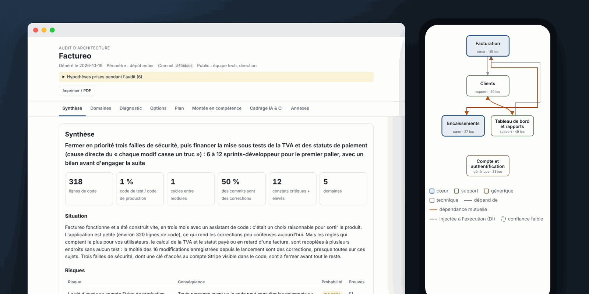
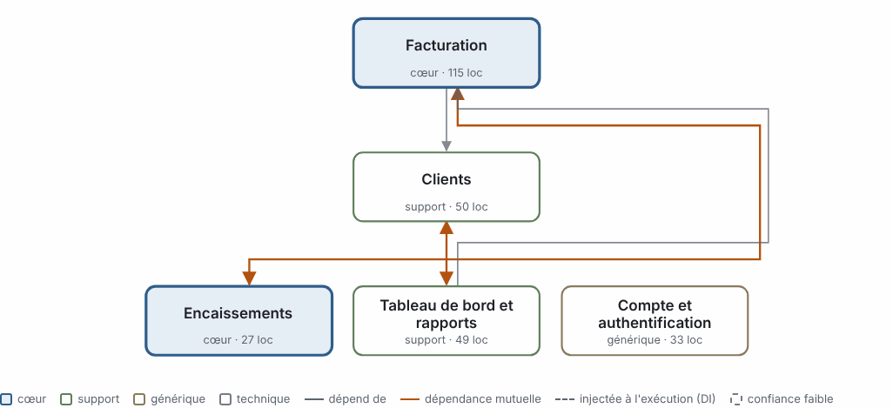
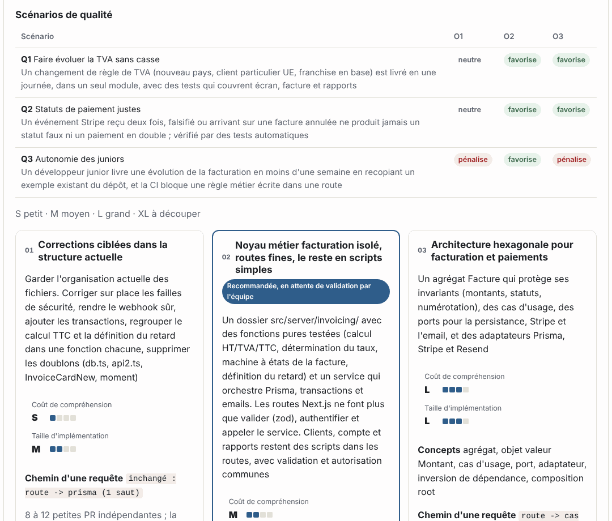
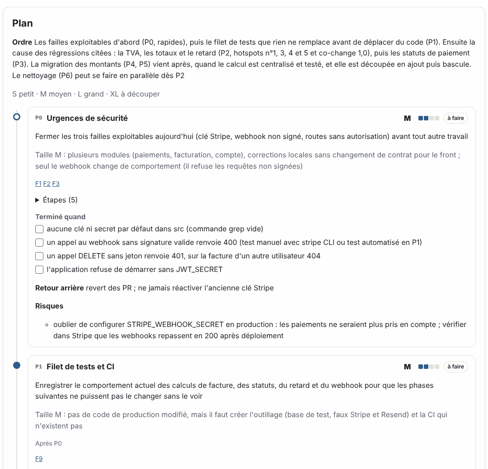
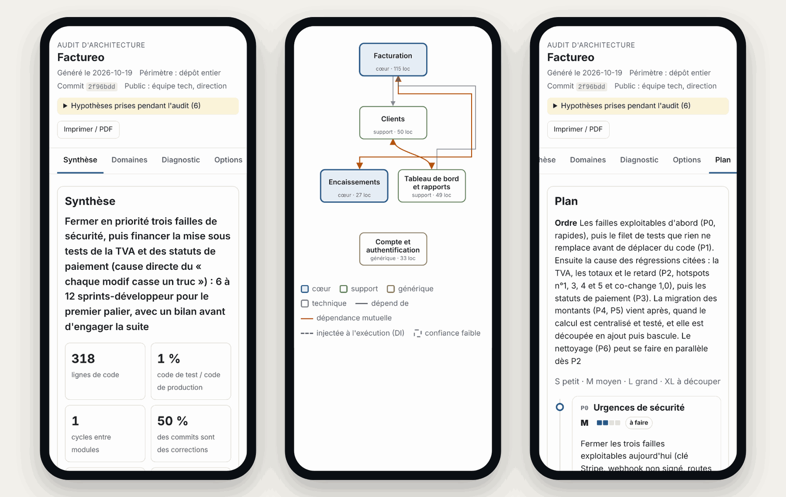

# re-arch

[English](README.md) | [Français](README.fr.md) | [Español](README.es.md) | [Deutsch](README.de.md) | **Português** | [Italiano](README.it.md) | [简体中文](README.zh-CN.md) | [日本語](README.ja.md) · **[Site](https://gregorybabonaux.github.io/re-arch/?lang=pt)**



Uma suíte de agent skills que audita a arquitetura de uma aplicação existente, propõe arquiteturas-alvo dimensionadas pelo custo de entendê-las e de construí-las, planeja o refactoring, apresenta o caso para a gestão, enquadra os agentes de código com IA e a CI em torno do alvo escolhido e produz material de treinamento baseado no próprio código da equipe. Pensada para qualquer codebase, e especialmente para as vibe-coded ou geradas por IA.

Ecossistemas suportados: JavaScript / TypeScript, PHP, .NET (C#), Java / Kotlin, C / C++, Go, Rust.

## O que você obtém

Rode `re-arch-audit` em um repositório e você obtém, em `.re-arch/`:

- um **mapa de domínios** da aplicação (áreas de negócio, dependências, sistemas externos como uma visão de contexto C4, zonas nebulosas, nível de confiança por domínio), mesmo quando a estrutura de pastas não diz nada;
- um **diagnóstico** em que cada finding cita arquivos e linhas, com seu impacto para a equipe e para o negócio e seu tamanho de correção, além dos pontos fortes a manter, **o que parece ruim mas está ok** e as perguntas em aberto para os mantenedores;
- **2 a 4 opções de alvo** (de "refactoring pontual, mesma estrutura" até camadas, vertical slices, monólito modular, clean / hexagonal, CQRS ou event sourcing quando o código justifica), cada uma dimensionada em **custo de entendimento** e **tamanho de implementação** (S, M, L, XL), avaliada contra os **cenários de qualidade** do negócio, possivelmente diferente por domínio, com os estilos considerados e descartados;
- um **plano de refactoring em fases** em tamanhos de camiseta com critérios explícitos: primeiro uma rede de segurança de testes de caracterização, passos com um comando `verify`, exit gates, rollback, pontos de parada e cobertura de todos os findings críticos e altos;
- um **pitch para a gestão**: riscos, opções incluindo não fazer nada, investimento como faixa de capacidade com sua derivação, marcos, indicadores, decisão solicitada;
- **guardrails**: AGENTS.md na raiz e por domínio, uma project skill que diz aos agentes onde colocar código novo, um **agent hook** que roda a verificação de arquitetura no próprio turno do agente, fitness functions para a CI adotadas com uma **baseline congelada** (ferramentas nativas por ecossistema mais um checker agnóstico de linguagem), um ADR (MADR 4), um checklist de revisão;
- uma **academy**: uma trilha de aprendizado alinhada ao plano, módulos ancorados em arquivos reais do repositório (antes/depois, katas, perguntas de revisão), leituras selecionadas;
- um **relatório HTML responsivo** reunindo tudo, validado contra o contrato de dados e verificado em largura de celular, imprimível em PDF, além de diagramas Mermaid para a documentação do repositório;
- um **bundle [Open Knowledge Format](https://github.com/GoogleCloudPlatform/knowledge-catalog/blob/main/okf/SPEC.md) (OKF v0.2)** do conhecimento de arquitetura (sistema, domínios, sistemas externos, decisão, regras, roadmap, histórico), para commitar em `docs/architecture/okf/` para pessoas, agentes de código e catálogos de conhecimento; campos de confiança indicam o que a equipe validou, e conteúdo sensível fica de fora;
- **re-auditorias** que mostram o que foi resolvido, o que é novo e como as métricas evoluíram.

## Exemplo de relatório

Gerado pelo re-arch sobre o *Factureo*, um app de faturamento fictício feito com vibe coding para as evals (o relatório está em francês). [Baixe o relatório completo](docs/example/report-factureo.html) e abra-o em um navegador.

**Mapa de domínios**: domínios de negócio e suas dependências, dependências mútuas em laranja.



**Opções**: de 2 a 4 arquiteturas-alvo, cada uma dimensionada em custo de compreensão e tamanho de implementação, avaliadas pelos cenários de qualidade do negócio.



**Plano**: fases com tamanho, critérios de saída, rollback e pontos de parada.



**No celular**: cada aba é verificada com 390 px de largura.



## Skills

| Skill | Papel | Scripts |
|---|---|---|
| `re-arch-audit` | orquestrador, checkpoints para validação de domínios e escolha de opção, modo de re-auditoria | `diff_rearch.py` |
| `re-arch-scan` | grafo de dependências (com precisão de compilador quando possível), wiring de DI, unidades de build, acoplamento, ciclos, hotspots, co-change, distribuição de conhecimento, duplicação, modelo de dados, rotas, sistemas externos, higiene de dependências, secrets | `scan.py`, `precise.py`, `di.py`, `insights.py`, `ts_resolve.js`, `php_refs.php` |
| `re-arch-domains` | domínios de negócio a partir de imports + DI + co-change + modelo de dados + rotas | `cluster.py` (Louvain) |
| `re-arch-diagnose` | findings com evidências, severidade e tamanho de correção; catálogo de smells com listas "não sinalizar" | |
| `re-arch-options` | arquiteturas-alvo, dimensionamento em dois eixos, cenários de qualidade, tabela de racionalização, catálogo de estilos, idiomas por ecossistema | |
| `re-arch-plan` | plano em fases, passos verificáveis, exit gates, técnicas incrementais | `plan_to_md.py` |
| `re-arch-pitch` | caso para a gestão | `pitch_to_md.py` |
| `re-arch-guardrails` | regras para agentes, project skill, agent hooks, fitness functions com baseline, ADR | `check_architecture.py` (+ scanner vendorizado) |
| `re-arch-academy` | material de treinamento sobre o próprio código da equipe | |
| `re-arch-report` | relatório HTML, validação do contrato, verificação de renderização, exportação Mermaid e OKF | `render.py`, `validate.py`, `check_render.py`, `to_okf.py` |

Cada skill também funciona sozinha. Elas trocam dados por meio de arquivos JSON em `.re-arch/`; o contrato está em `skills/re-arch-audit/references/contract.md` e é aplicado por `validate.py`.

## Quão preciso é o grafo de dependências?

O scan usa as ferramentas da própria linguagem quando estão disponíveis e informa isso na seção "Graph sources"; caso contrário, recorre à resolução por regex.

| Ecossistema | Fonte precisa | Requer |
|---|---|---|
| C/C++ | `compile_commands.json` (`-I`/`-D` reais) + árvore de includes do pré-processador | um compile database (CMake `-DCMAKE_EXPORT_COMPILE_COMMANDS=ON`, `bear`), um compilador |
| Go | `go list` (build tags, caminhos de módulo exatos) | toolchain Go |
| Rust | `cargo metadata` (grafo de crates, `use` entre crates) | Cargo |
| Java/Kotlin | `jdeps` sobre as classes compiladas | um JDK e um projeto compilado |
| .NET | grafo de ProjectReference dos `.csproj` (elimina arestas impossíveis) | nada |
| JS/TS | o próprio resolvedor de módulos do TypeScript | `typescript` no repositório, ou `--fetch-tools` |
| PHP | tokenizer do PHP com resolução completa de nomes | um binário `php` |

A injeção de dependência é resolvida à parte (registrations do .NET, providers do NestJS/Angular, bindings e facades do Laravel, services do Symfony, `@Bean` do Spring, Google Wire, implementações únicas) em **arestas de runtime**, mantidas separadas dos imports: as regras de camadas usam os imports, acoplamento e domínios usam ambos. Reflection e scanning baseado em convenções continuam invisíveis, e todo relatório diz isso.

## Escolhas de design

- **Evidências antes de opiniões**: um scan determinístico roda primeiro; os findings apontam para o código, e o diagnóstico mostra o que optou por não sinalizar.
- **Nenhuma arquitetura por padrão**: uma opção leve está sempre na mesa, toda opção precisa ser justificada por sinais no código e avaliada contra cenários de qualidade, e clean, hexagonal e onion são uma opção, não níveis de qualidade. "Manter a arquitetura atual" é um resultado legítimo.
- **O custo é visível**: custo de entendimento ao lado do tamanho de implementação.
- **Tamanhos, não dias**: tamanhos de camiseta com critérios explícitos; XL significa "divida"; a gestão recebe faixas de capacidade com sua derivação.
- **Dois públicos**: a área técnica recebe evidências e passos verificáveis, a gestão recebe riscos e decisões.
- **Refactoring que se sustenta**: fitness functions com baseline congelada, agent hooks, regras de agente por domínio, treinamento sobre o repositório, re-auditorias.
- **Pessoas não são findings**: a concentração de conhecimento é reportada com pseudônimos (`A1`, `A2`), e o mapeamento fica local.

## Requisitos

- Python 3.8+ (apenas a biblioteca padrão para o núcleo).
- Opcional, para o modo preciso: as toolchains das linguagens acima; Node para o resolvedor TypeScript.
- Opcional: Playwright + Chromium para verificar a renderização do relatório (`pip install playwright && python -m playwright install chromium`).
- Opcional: histórico git no repositório auditado (co-change, hotspots, conhecimento; evite shallow clones).

## Instalação

**Claude Code** (um passo, Claude Code 2.1.275 ou mais recente):

```
/plugin install re-arch --marketplace GregoryBabonaux/re-arch
```

Versões anteriores: `/plugin marketplace add GregoryBabonaux/re-arch` e depois `/plugin install re-arch@re-arch`.

**Qualquer outro agente** (Codex, Cursor, Gemini, Copilot…):

```
npx skills add GregoryBabonaux/re-arch
```

Adicione `-g` para instalar em todos os seus projetos.

Depois, no projeto a auditar, basta pedir: *"audite a arquitetura deste repositório"*.

Atualizar: `claude plugin update re-arch@re-arch` (Claude Code) ou `npx skills update`.

## Desenvolvimento

- `python3 tests/test_suite.py -v`: 34 testes sobre repositórios de fixture por ecossistema. Cada fixture planta armadilhas que a camada regex erra (includes calculados por macro, colisões de include-dir, `use` entre crates, nomes qualificados inline, colisões de namespace entre projetos, build tags, referências PHP no mesmo namespace) e verifica que a camada precisa e a extração de DI acertam; além disso, baseline e hooks do checker, validação do contrato, renderização em largura de celular, diffs de re-auditoria, exportação OKF (conformidade, campos de confiança, histórico do log, nada sensível). Os testes que dependem de toolchain são pulados quando a toolchain está ausente.
- `python3 tools/sync.py` depois de alterar o scanner (a skill de guardrails vendoriza uma cópia); `--check` na CI.
- `evals/`: evals end-to-end (`evals.json`, avaliados por `evals/grade.py`), incluindo um repositório saudável em que a resposta certa é "não migrar para hexagonal", e consultas de acionamento para as descrições das skills (`triggers.json`).
- `.github/workflows/tests.yml` roda tudo isso.
